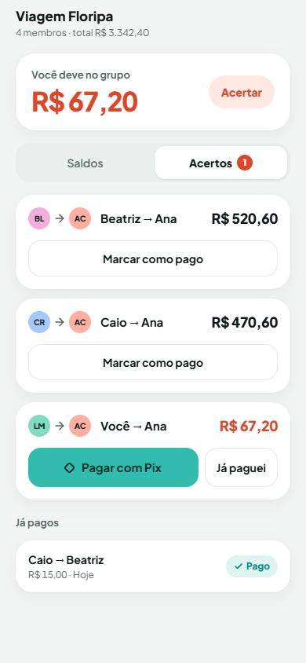
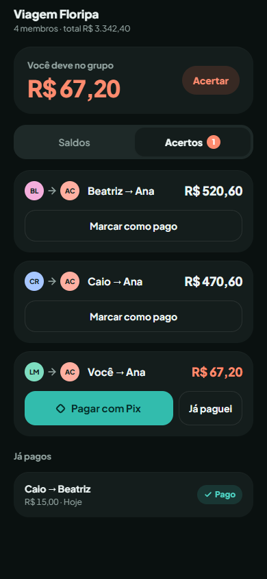
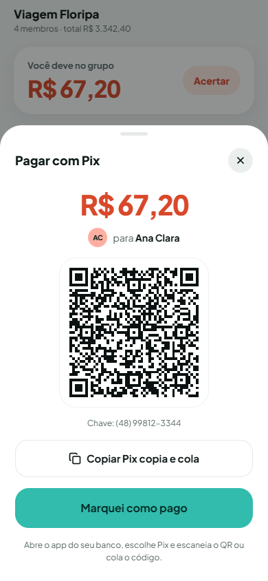
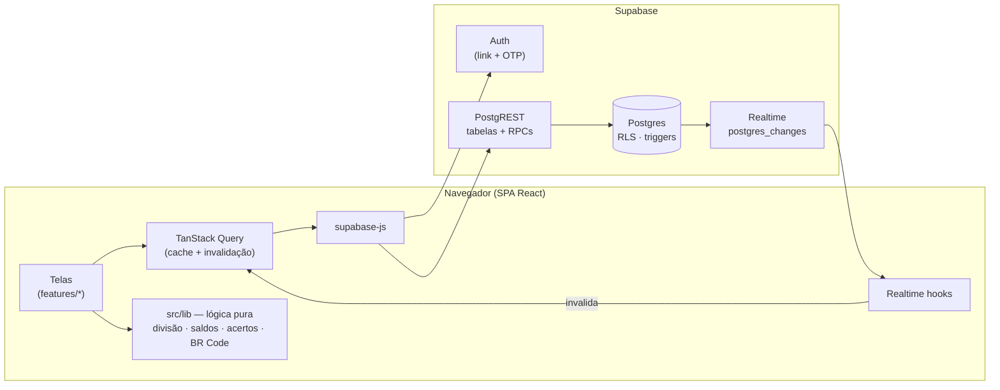
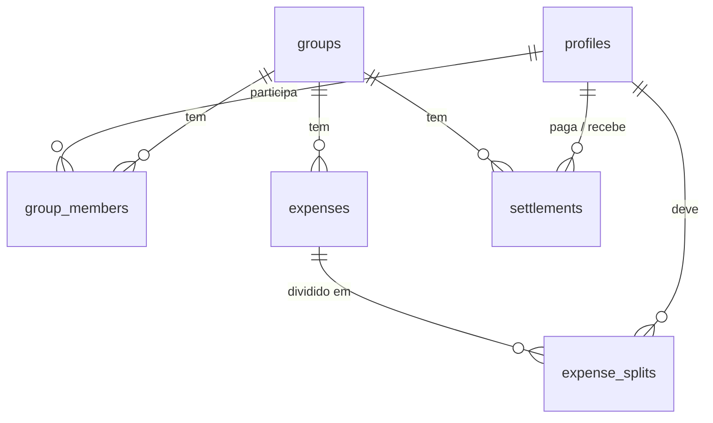

# Racha Aí
Fiz para preencher um pouco do portfólio, espero que gostem!

> **Racha a conta, não a amizade.** Web app mobile-first para dividir os gastos da viagem, da rep e do rolê — e acertar tudo com um Pix.

**▶ Ao vivo:** [racha-ai-liart.vercel.app](https://racha-ai-liart.vercel.app)

Cada pessoa lança o que pagou, o app calcula quem deve quanto pra quem, sugere o menor número razoável de transferências e gera o **QR Code Pix** (BR Code) de cada acerto, com o valor já preenchido.

| Claro | Escuro |
|---|---|
|  |  |
|  |  |

---

## Funcionalidades

- **Login sem senha**: link mágico **e** código de 6 dígitos no mesmo e-mail (funciona mesmo abrindo o e-mail em outro aparelho).
- **Grupos com convite por link** (`/c/{código}`), compartilhável no WhatsApp; a lista "Já entraram" atualiza ao vivo.
- **Novo gasto** com teclado de centavos (aceita também o teclado físico), três modos de divisão — *igual pra todos*, *por valor* e *só alguns* — e validação que explica o que falta ("Os valores não fecham").
- **Saldos** por pessoa com barras de eixo central e **acertos sugeridos**.
- **Pagar com Pix**: QR Code e "Pix copia e cola" gerados no navegador, com valor e chave do credor.
- **Chave Pix privada**: só aparece para quem está devendo para o dono da chave.
- **Tempo real**: gastos, pagamentos e membros aparecem na hora para todo o grupo.
- **Modo claro/escuro**: segue o sistema; o switch do Perfil sobrescreve e fica salvo.
- Estados de carregamento (skeletons), vazio e erro em todas as telas.

## Stack

| Camada | Escolha |
|---|---|
| UI | React 19 + TypeScript + Vite, Tailwind CSS 4 (tokens do design como CSS custom properties), lucide-react |
| Dados | TanStack Query, React Hook Form + Zod |
| Backend | Supabase: Auth (e-mail OTP), Postgres com RLS, RPCs em PL/pgSQL, Realtime |
| Pix | BR Code próprio (EMV + CRC16) + `qrcode.react` |
| Testes | Vitest (124 testes, incluindo testes de propriedade) |
| Deploy | Vercel (SPA) |

---

## Arquitetura



**Princípios**

- **Dinheiro sempre em centavos (`integer`)**, do banco ao formulário. Float só na hora de formatar.
- **O banco é a fonte da verdade das regras.** O front valida para dar feedback rápido, mas quem garante é o Postgres:
  - RLS em todas as tabelas: só membros leem/escrevem dados do grupo; editar/excluir gasto só para quem criou ou pagou.
  - *Constraint trigger* `DEFERRABLE INITIALLY DEFERRED`: no commit, a soma das partes tem que bater com o valor do gasto e todo mundo envolvido tem que ser membro.
  - `leave_group` recusa a saída com saldo ≠ 0; `get_pix_key` só entrega a chave para quem deve a quem tem a receber.
- **Lógica de negócio pura e testada em `src/lib`**, sem React nem rede — as telas só montam os dados e chamam essas funções.
- **Realtime só invalida queries**: o evento avisa "algo mudou" e o TanStack Query rebusca com as regras de acesso já aplicadas.

### Estrutura

```
src/
  api/            supabase-js, hooks do TanStack Query, realtime, tipos gerados do banco
  auth/           AuthProvider (sessão)
  app/            router, guards (sessão, perfil, convite), shell mobile
  components/     componentes do design: Avatar, BalanceBadge, SplitChip, ExpenseCard, BottomSheet, Toast…
  features/       telas: auth, onboarding, profile, home, groups, expenses, balances, settle
  lib/            lógica pura + testes (split, balances, settle, pix-key, pix-payload, money, dates…)
  dev/            prancha de componentes e prévias sem login
supabase/
  migrations/     schema, RLS, triggers, RPCs, realtime
  templates/      e-mails de login em pt-BR (link + código)
design/           handoff do design (referência, não é código de produção)
```

### Modelo de dados



| RPC | O que faz |
|---|---|
| `my_groups_summary()` | Home numa chamada: grupos, contadores, total e meu saldo |
| `save_expense(payload)` | Cria ou edita gasto + partes numa transação (SECURITY INVOKER: valem as policies) |
| `join_group(code)` | Entra pelo convite (idempotente) |
| `leave_group(gid)` | Sai do grupo, só com saldo 0 |
| `get_my_profile()` | Meu perfil, com a minha chave Pix |
| `get_pix_key(creditor, gid)` | Chave do credor, só se eu devo e ele tem a receber |

A coluna `pix_key` não é legível via API por ninguém (column privileges): o dono lê pela `get_my_profile`, os outros pela `get_pix_key`.

---

## Como a conta fecha

### 1. Divisão igual sem perder centavo

`splitEqually(total, pessoas)`: `base = floor(total / n)` e os primeiros `total − base·n` recebem +1 centavo. R$ 100,00 entre 3 → 33,34 + 33,33 + 33,33. A soma é sempre exata (testado com 1.000 casos aleatórios).

### 2. Saldos

Para cada gasto: **+valor** para quem pagou e **−parte** para cada participante. Para cada pagamento registrado: quem pagou **+valor**, quem recebeu **−valor**. Saldo positivo = tem a receber; negativo = deve. A soma dos saldos do grupo é sempre **zero** — uma propriedade verificada em 500 grupos gerados aleatoriamente.

### 3. Acertos sugeridos (guloso)

```
enquanto houver devedor e credor:
  d = maior devedor, c = maior credor      (re-escolhidos a cada passo)
  x = min(|saldo d|, saldo c)
  sugere "d paga x para c"; atualiza os dois saldos
```

Cada passo zera pelo menos uma pessoa, então são **no máximo n − 1 transferências** para n pessoas com saldo ≠ 0 — um greedy que **reduz** bastante o número de transferências na prática. **Não é garantidamente o mínimo**: encontrar o número mínimo de transferências é NP-difícil (equivale a particionar os saldos no maior número de subconjuntos de soma zero). Para grupos de amigos, o greedy é simples, previsível e bom o suficiente. Empates são desfeitos pelo id, para a lista não "pular" entre atualizações.

## BR Code (Pix copia e cola)

O QR é gerado no próprio app, sem API externa. O payload segue o padrão **EMV-MPM** do Banco Central: uma sequência de campos `ID (2) + tamanho (2) + valor`.

| ID | Campo | Exemplo |
|---|---|---|
| `00` | Versão do payload | `01` |
| `26` | Conta Pix: `00` = `br.gov.bcb.pix`, `01` = chave | `0014br.gov.bcb.pix0114+5548998123344` |
| `52` | Categoria (MCC) | `0000` |
| `53` | Moeda (BRL) | `986` |
| `54` | Valor | `67.20` |
| `58` | País | `BR` |
| `59` | Nome do recebedor (sem acento, maiúsculo, ≤ 25) | `ANA CLARA` |
| `60` | Cidade (≤ 15; o app usa `SAO PAULO`) | `SAO PAULO` |
| `62` | Dados adicionais: `05` = txid (alfanumérico ≤ 25) | `0520RACHAAI…` |
| `63` | CRC16-CCITT-FALSE (poly `0x1021`, init `0xFFFF`) sobre tudo, incluindo `6304` | `974A` |

Resultado real gerado pelo app:

```
00020126360014br.gov.bcb.pix0114+5548998123344520400005303986540567.205802BR5909ANA CLARA6009SAO PAULO62240520RACHAAIdefa0000000006304974A
```

Os testes conferem o CRC contra o vetor padrão (`"123456789"` → `29B1`), contra uma segunda implementação por tabela e contra o **exemplo oficial do Manual de Padrões para Iniciação do Pix** (CRC `1D3D`).

A chave é normalizada antes de ir para o banco e para o QR: CPF só com dígitos e dígitos verificadores válidos, celular como `+55DDDNÚMERO`, e-mail em minúsculas e chave aleatória como UUID v4.

---

## Rodando localmente

**Requisitos:** Node 20+ e um projeto no [Supabase](https://supabase.com).

```bash
npm install
cp .env.example .env.local   # preencha com os dados do seu projeto
npm run dev                  # http://localhost:5173
```

`.env.local`:

```
VITE_SUPABASE_URL=https://SEU-PROJETO.supabase.co
VITE_SUPABASE_PUBLISHABLE_KEY=sb_publishable_...
```

Use a chave **publishable** (Project Settings → API Keys). Nunca a `secret`/`service_role`: tudo que começa com `VITE_` vai para o navegador.

### Banco

Aplique as migrations de `supabase/migrations/` em ordem — pela CLI (`supabase link` + `supabase db push`) ou colando os arquivos no SQL Editor do painel.

### Login por e-mail (link + código)

O app pede ao Supabase um e-mail que traz **o link e o código de 6 dígitos**. Para isso:

1. **SMTP próprio** (Authentication → Emails → SMTP Settings). O serviço padrão do Supabase só entrega para membros do projeto e não permite personalizar o e-mail. Para um projeto pessoal, uma conta Gmail dedicada com *senha de app* funciona (`smtp.gmail.com`, porta `465`); em produção, prefira um serviço como Resend ou Postmark com domínio próprio.
2. **Templates** (Authentication → Emails → Templates) — o código só é enviado se o template tiver `{{ .Token }}`:
   - **Magic Link** ← conteúdo de [`supabase/templates/magic_link.html`](supabase/templates/magic_link.html)
   - **Confirm signup** ← conteúdo de [`supabase/templates/confirmation.html`](supabase/templates/confirmation.html) (é o e-mail de quem entra pela primeira vez)
   - Assunto sugerido para os dois: `Seu código do Racha Aí: {{ .Token }}`

   Os dois precisam conter `{{ .ConfirmationURL }}` (o link) **e** `{{ .Token }}` (o código). No app, o código é verificado com `supabase.auth.verifyOtp({ email, token, type: 'email' })`.
3. **URL Configuration**: *Site URL* = endereço do app; em *Redirect URLs*, adicione `http://localhost:5173/**` e, depois do deploy, `https://SEU-APP.vercel.app/**`. Sem isso, o link do e-mail cai no Site URL padrão.
4. **Email OTP Length** (Authentication → Sign In / Providers → Email) = **6**.

### Scripts

| | |
|---|---|
| `npm run dev` | servidor de desenvolvimento |
| `npm test` | testes (Vitest) |
| `npm run lint` | ESLint |
| `npm run typecheck` | TypeScript |
| `npm run build` | typecheck + build de produção em `dist/` |

### Páginas de desenvolvimento

Funcionam sem login, com dados fictícios, e não gravam nada:

- `/dev/componentes` — prancha de componentes, claro e escuro lado a lado
- `/dev/novo-gasto` — formulário real de novo gasto
- `/dev/acertos` — saldos, acertos e modal Pix com os dados do protótipo

## Deploy na Vercel

1. Importe o repositório na Vercel (framework **Vite**; build `npm run build`, saída `dist`).
2. Em *Environment Variables*, cadastre `VITE_SUPABASE_URL` e `VITE_SUPABASE_PUBLISHABLE_KEY`.
3. O [`vercel.json`](vercel.json) reescreve todas as rotas para `/index.html`, então `/g/…` e `/c/…` funcionam ao abrir o link direto.
4. No Supabase, adicione a URL da Vercel em *Site URL* e *Redirect URLs* (passo 3 acima).

---

## Decisões e ajustes em relação ao design

O design (em [`design/`](design/)) é a especificação visual. Alguns ajustes feitos na implementação:

- Card de grupo: o nome usa a largura toda (até 2 linhas) e o badge vai para a linha de "membros · gastos", com a legenda só se couber.
- Totais "A receber / A pagar" sem quebra de linha e com fonte relativa ao card, para caber R$ 99.999,99.
- Lista de gastos agrupada por dia ("Hoje", "Ontem", "16 set"); o card mostra só "{Quem} pagou".
- Perfil rolável com botões que não encolhem; toda área rolável reserva espaço para o FAB e o botão fixo.
- Telas novas no mesmo estilo: onboarding, detalhe do gasto (editar/excluir com confirmação na própria tela), login com código e "Sair do grupo".
- Link mágico em fluxo *implicit* (funciona se aberto em outro navegador/app); convite pendente redirecionado pelo próprio link do e-mail, já que ele abre em aba nova.

## Limitações conhecidas

- Quem sai de um grupo continua nos gastos antigos, mas aparece como "Ex-membro" (o perfil deixa de ser visível para o grupo).
- Quem só pagou um gasto (sem ter criado) não consegue trocar o "quem pagou" para outra pessoa — perderia a própria permissão no meio da edição.
- O app não coleta cidade; o campo 60 do BR Code usa `SAO PAULO` (o banco do pagador não usa esse campo para roteamento).
